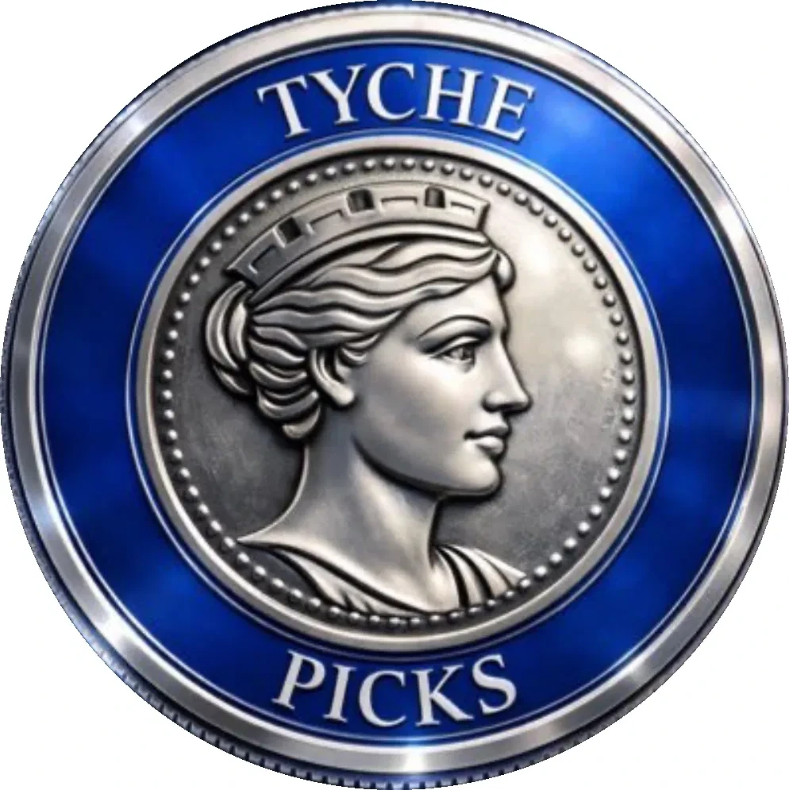
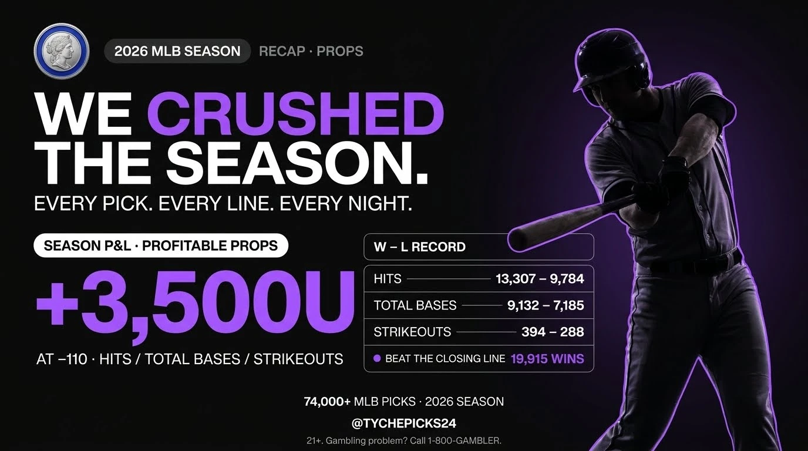

# Tyche Picks — DESIGN.md

<p align="center"></p>

> **Sources:** Colors sampled from a tychechat.com screenshot (2026-11-03). Logo: `tyche-coin-logo.png`, supplied by the client. Voice and lines come from the Figma Make file "Tyche Picks Brand Guidelines" v1.0 (`QHpsMfIuKRxacwYLYb8Cmx`). Poster types come from 6 public @TychePicks posts observed on 2026-11-03. The structure follows the Google Stitch DESIGN.md format used in [VoltAgent/awesome-design-md](https://github.com/VoltAgent/awesome-design-md).
>
> **Status:** This is a draft direction and the client has not confirmed it. The Figma mauve/green palette and TP monogram are **superseded** (see Appendix).
>
> **Accuracy note:** The hex values were sampled from a screenshot, so they can be off by a few units because of compression and display profile. The typeface is not confirmed; Plus Jakarta Sans is a stand-in. Pixel type sizes, radii, spacing, component specs and poster formats are proposals made for this document.

## Overview

Tyche Picks posts sports picks backed by a model and sells access to Tyche Chat, an AI picks assistant. The look matches the Tyche Chat app: a near-black ground, layered dark panels, cool gray text and one violet accent. The coin logo is the only object with its own color (silver and royal blue). Everything else stays neutral so the coin and the pick stand out.

**Key Characteristics:**
- A near-black ground (#0A0A0A) with panels stepped one shade lighter (#141414 → #1E1E1E). Depth comes from these value steps, not from glow.
- **Violet budget:** each poster gets at most one hero number, one highlighted word and one highlighted row in #9D59EF, plus a violet rim light on photos. Violet is the only bright color.
- The Tyche coin appears as supplied on every poster. It is never redrawn or recolored.
- Headlines are extra-bold geometric sans with tight tracking. Labels are small, uppercase and widely tracked.
- Photos are near-monochrome with a violet rim light and show anonymous players only.
- A mandatory legal footer.

## Colors

### Brand & Accent
- **Accent Violet** (`{colors.accent}`, #9D59EF): The only bright color. Use it for the hero number (odds, units, record), one highlighted word, buttons, and the rim light on photos. **Budget per poster:** 1 hero number + 1 highlighted word + 1 highlighted row, at most. A poster with fewer violet elements is fine.
- **Coin silver and royal blue:** these belong to the logo only. No other blue or silver may appear in a layout.

### Surface
- **Background** (`{colors.background}`, #0A0A0A): The main ground of every poster.
- **Panel** (`{colors.panel}`, #141414): Cards, stat panels and leg rows.
- **Raised** (`{colors.raised}`, #1E1E1E): Stat boxes inside panels, active states, dividers, and 1px panel borders.

### Purple Fills
- **Deep Purple** (`{colors.purple-fill}`, #271A38): Pills and primary buttons on dark.
- **Darkest Purple** (`{colors.purple-fill-dark}`, #191221): The one highlighted row (e.g. the Play of the Day leg) and secondary buttons.
- **Purple Border** (`{colors.purple-border}`, #4B2D6F): The 1px outline on purple fills.

### Text
- **Text** (`{colors.text}`, #E7E6E6): Headlines, team names and stat values.
- **Secondary** (`{colors.text-secondary}`, #97A3B6): Labels (ODDS, % CONFIDENCE), taglines, captions and the **legal footer**.
- **Muted** (`{colors.text-muted}`, #505660): Decorative fine print only. Its contrast is about 2.4:1 on #141414, which fails for small important text. Never use it for the disclaimer, odds or anything the reader must read.

### Not in the palette
No green, gold, yellow, extra blue, or white (#FFFFFF). The current live posts use navy, neon and gold, and this system replaces all of them.

## Logo — the Tyche Coin

<p align="center"></p>

- **File:** `assets/tyche-coin-logo.png` (994 × 995).
- **Description (use in prompts as well):** "A round silver coin with a royal-blue enamel ring. The serif word TYCHE runs along the top and PICKS along the bottom. In the center is a silver relief profile of the goddess Tyche facing right, wearing a mural (tower) crown, inside a beaded border."
- **Never** redraw, recolor, re-letter or crop the coin, change the face, or add effects to it (glow, outline, bevel, 3D tilt).
- The coin keeps its own silver and blue, so the rest of the layout uses neither.
- **Clear space:** at least 25% of the coin's diameter on all sides.
- **Minimum size on posters:** 120px diameter on a 1080px canvas. Below that, the lettering becomes unreadable.
- **Placement:** top-left or top-center at 140–200px for data posters. It can be the hero at 40–60% of the canvas width on Premium and season-recap posters.
- Tyche Chat uses the same coin as its avatar. Keep the two identical.

## Typography

### Font Family
- **Plus Jakarta Sans** (Google Fonts, 400–800) is a stand-in until the client confirms the Tyche Chat typeface.
- The style is clean geometric sans: extra-bold, tight headlines and small, uppercase, widely tracked labels.
- The serif lettering on the coin is part of the logo image. Do not set any other text in a serif.

### Hierarchy
Sizes are for a 1080px-wide canvas. Scale them proportionally for other formats.

| Token | Size | Weight | Line Height | Letter Spacing | Use |
|---|---|---|---|---|---|
| `{typography.display-xl}` | 200px | 800 | 0.80 | −0.07em | Hero number: odds, units, record (in violet) |
| `{typography.display-lg}` | 128px | 800 | 0.84 | −0.065em | Headline word: CASHED, PARLAY, team name |
| `{typography.display-md}` | 80px | 800 | 0.90 | −0.05em | Secondary headline, total odds |
| `{typography.title}` | 44px | 700 | 1.0 | −0.03em | Leg team names, panel titles |
| `{typography.stat}` | 64px | 800 | 0.90 | −0.04em | ODDS / % CONFIDENCE values (tabular figures) |
| `{typography.label}` | 22px | 600 | 1.1 | +0.14em, CAPS | Stat labels, league tags, pill text |
| `{typography.body}` | 26px | 400 | 1.5 | 0 | Taglines, supporting lines |
| `{typography.legal}` | 18px | 400 | 1.3 | +0.02em | Legal footer |

### Principles
- Numbers are the hero. Odds, units and % are larger than team names.
- Use 3 type levels per poster at most.
- In a headline, one word may be violet. The rest is #E7E6E6.
- Image models misspell text and get digits wrong. See Agent Prompt Guide.

## Layout

### Spacing System
- Base unit 16px. Poster padding is 48px. Space between sections is 32px. Space before the footer is 48px.

### Poster Formats (X)
| Name | Size | Use |
|---|---|---|
| Landscape | 1200 × 675 | Default timeline image. Gemini 16:9 output is 1376 × 768, which is acceptable as is. |
| Portrait | 1080 × 1350 | Parlay cards with 3+ legs, season recap boards |
| Square | 1080 × 1080 | Play of the Day, CASHED |

### Whitespace Philosophy
Leave at least 30% of the poster as background. Leg rows stack with a 16px gap. If a parlay has more than 4 legs, switch to Portrait.

## Elevation & Depth

| Level | Treatment | Use |
|---|---|---|
| 0 | #0A0A0A flat | Poster ground |
| 1 | #141414 + 1px #1E1E1E border | Panels, leg rows |
| 2 | #1E1E1E | Stat boxes inside panels |
| Highlight | #191221 + 1px #4B2D6F border | The one highlighted row |

### Decorative Depth
- No neon glow, no chrome, no gold, no lens flares. These belong to the current live posts and are replaced.
- Light comes only from **violet rim light** on photography, and it is subtle.

### Photography
- Near-monochrome with deep blacks and a #9D59EF rim light.
- **Anonymous players only:** no faces, no team logos, no jersey numbers. Real team and league logos are placed in Figma after generation.

## Components

### Leg Row (Parlay Card)
A #141414 panel with a 1px #1E1E1E border and a 16px radius. Contents, left to right:
- team logo slot (64px, filled after generation)
- `[TEAM A] vs [TEAM B]` in `{typography.title}`
- **ODDS** stat box
- **% CONFIDENCE** stat box

To highlight the strongest leg, use `leg-row-highlight` on one row only. The total odds appear in `{typography.display-md}`. They count as the poster's hero number if they are set in violet.

### Stat Box
A #1E1E1E box with a 24px radius. It holds a label in #97A3B6 CAPS above a value in #E7E6E6 `{typography.stat}`.

### Pill
A #271A38 fill with a 1px #4B2D6F border and #E7E6E6 label text. Use it for league tags, "PLAY OF THE DAY", "PREMIUM", and CTAs such as "Ask Tyche Chat".

### Play of the Day
On a square canvas:
- coin at top-left
- "PLAY OF THE DAY" pill
- `[PICK]` in display-lg
- `[ODDS]` hero number in violet display-xl
- a monochrome anonymous player photo with violet rim light

Team colors are not used.

### CASHED Receipt
A panel listing each leg with a ✅ in #E7E6E6. "CASHED" appears in display-lg, and `+[UNITS]u` is the violet hero number. The record line reads `[RECORD]` in secondary text.

### Season Recap Board
The approved reference is `examples/2026-mlb-season-recap.png` (see Creating Graphics). It can be Landscape or Portrait. It contains:
- the coin and a season pill in the header
- a two-line headline with one violet word (e.g. "WE *CRUSHED* THE SEASON.")
- the `+[UNITS]U` violet hero number with its basis line (e.g. "AT −110 · …")
- a W–L panel: outlined rows with dotted leader lines from the prop name to `[W] – [L]`, and one highlighted violet row
- a photo of an anonymous player with a violet rim light on one side

Every number must come from the client's data.

### Premium / Tyche Chat Promo
The coin is the hero at 50% of the width. Include the line "Fortune favors the informed.", one violet number (`+[UNITS] units`), and a pill CTA "Try Tyche Chat" with the tychechat.com URL in secondary text.

### Legal Footer (mandatory)
Bottom of every poster, in `{typography.legal}`, color #97A3B6 (not #505660):
`21+. Gambling problem? Call 1-800-GAMBLER.`
Tyche Chat uses "18+ · For informational purposes only · Not gambling advice". The age line is unresolved; see Known Gaps.

## Voice & Copy

| Trait | Definition (Figma brand file) | Example |
|---|---|---|
| Informed | Show the thinking. Make the value obvious. | "Model edge: [EDGE]% over market." |
| Decisive | Say what matters, then stop. | "[PICK]. That's the play." |
| Optimistic | Build belief without making promises. | "Reset. Next slate is up." |
| Human | Sound like a sharp friend, not a spreadsheet. | "Good judgment. Better energy." |

- Rule: **Confident, never cocky.** Avoid "lock", "guaranteed", "free money", and "can't lose".
- Lines: *Fortune favors the informed.* · *Pick smart. Feel lucky.* · *Good judgment. Better energy.*
- Current caption tagline (unconfirmed whether it stays): "Trust the data | Trust the model | Trust in Tyche".
- X caption formula: 🚨 + sport emoji → CAPS headline → one line per leg (emoji + pick + % + odds) → engagement hook → `#TychePicks #TycheModel`.

### Data Placeholders
`[TEAM A]` `[TEAM B]` `[PICK]` `[ODDS]` `[UNITS]` `[RECORD]` (plus `[EDGE]`, `[SPORT]`).
**Never invent results, odds, units or records.**

## Do's and Don'ts

### Do
- Use the supplied coin PNG on every poster, unchanged.
- Keep within the violet budget: 1 number + 1 word + 1 row.
- Set the footer in #97A3B6.
- Check every digit after generation.
- Place real team and league logos in Figma after generation.

### Don't
- Don't redraw or recolor the coin, and don't add blue or silver elsewhere.
- Don't use green, gold, yellow, neon glow, chrome or navy.
- Don't use serif type outside the coin.
- Don't show player faces, jersey numbers or team logos in generated photos.
- Don't invent numbers.
- Don't reuse the TP monogram, mauve/green palette, or neon-violet/Anton drafts.

## Responsive Behavior

### Breakpoints
| Name | Width | Key Changes |
|---|---|---|
| X timeline preview | ~600px rendered | Labels must stay ≥ 22px at 1080 wide. The coin must stay ≥ 120px. |
| Landscape 1200 × 675 | 1200px | Legs go into two columns at 4. The hero number drops to display-lg. |
| Portrait 1080 × 1350 | 1080px | Full stack, up to 5 legs, recap grids. |

### Collapsing Strategy
When space runs out, drop elements in this order: tagline → photo → % CONFIDENCE label text (keep the value). The coin, the pick, the odds and the legal footer are never dropped.

### Image Behavior
Generated imagery stays out of the coin zone and the bottom 120px (footer).

## Creating Graphics

### Process
1. **Collect the data:** get the exact numbers from the client (records, units, odds, pick count) as text. Do not read them off old posters.
2. **Check the numbers:** recompute any derived figure (units from W–L, totals) before writing the prompt. An example follows.
3. **Choose the template:** Parlay, Play of the Day, CASHED, Season Recap, or Promo (see Components).
4. **Fill the prompt:** use the template in the Agent Prompt Guide. Quote every string exactly.
5. **Generate:** attach the coin PNG only, and make 2–3 attempts at most.
6. **QA:** run the checklist below.
7. **Fix in Figma:** paste the real coin over the generated one, retype any wrong digits, and place league logos if needed.
8. **Export:** PNG, at 1200 × 675 / 1376 × 768, 1080 × 1350 or 1080 × 1080.

### QA Checklist
- [ ] Every digit matches the client's data
- [ ] The coin is unchanged: silver and blue, TYCHE / PICKS spelled correctly, profile facing right
- [ ] Violet use is within budget: ≤ 1 number, ≤ 1 word, ≤ 1 row
- [ ] No green, gold, yellow, navy, chrome or glow
- [ ] The player is anonymous: no face, logo or jersey number
- [ ] The handle is correct (@TychePicks vs @TYCHEPICKS24, unresolved)
- [ ] The footer is present, readable, and spelled correctly
- [ ] There is no extra or invented text

### Worked Example — 2026 MLB Season Recap

<p align="center"></p>

`examples/2026-mlb-season-recap.png`: 1376 × 768, made by the client in Gemini. It is the reference for the Season Recap Board template.

**Layout zones (left to right, top to bottom)**
| Zone | Content | Style |
|---|---|---|
| Header | Coin + pill "2026 MLB SEASON" + "RECAP · PROPS" | Dark gray pill (#1E1E1E range), secondary text |
| Headline | "WE **CRUSHED** THE SEASON." | Extra-bold caps, #E7E6E6, one violet word |
| Subline | "EVERY PICK. EVERY LINE. EVERY NIGHT." | Caps, regular weight, #E7E6E6 |
| Hero | Pill "SEASON P&L · PROFITABLE PROPS" + **+3,500U** + "AT −110 · HITS / TOTAL BASES / STRIKEOUTS" | Violet display number, basis line beneath |
| Data panel | W–L RECORD: Hits 13,307 – 9,784 · Total Bases 9,132 – 7,185 · Strikeouts 394 – 288 · ● Beat the closing line **19,915 WINS** | Outlined rows, dotted leaders, last row violet |
| Photo | Anonymous batter, mid-swing, right third | Near-monochrome with violet rim light and a soft violet glow behind |
| Footer | "74,000+ MLB PICKS · 2026 SEASON" · "@TYCHEPICKS24" · "21+. Gambling problem? Call 1-800-GAMBLER." | Centered, small, secondary gray |

**Review against this system**
| Rule | Result | Note |
|---|---|---|
| Violet budget | Pass | 1 word (CRUSHED), 1 number (+3,500U), 1 row (closing line) + rim light |
| Palette | Partial | The "SEASON P&L" pill is near-white with black text. Near-white is not a fill color in this palette. Use #271A38 / #4B2D6F instead, or accept it as an exception |
| Coin | Check | About 90px at 1376 wide (≈ 70px at 1080), below the 120px minimum. The lettering is not readable at that size |
| Photo | Pass | No visible face, logo or number |
| Footer | Pass | Present, in secondary gray |
| Handle | Open | @TYCHEPICKS24, which differs from @TychePicks on the profile |
| Numbers | Consistent | See the check below |

**Number check (instructional).** W = 13,307 + 9,132 + 394 = 22,833. L = 9,784 + 7,185 + 288 = 17,257. At −110, risking 1u per pick: 22,833 × (100/110) − 17,257 = **+3,500.3u**, which matches "+3,500U". Graded picks in the panel total 40,090, against "74,000+ MLB picks" in the footer. That difference may be other prop types or ungraded picks. Confirm it with the client before reusing the line. This check shows only that the numbers agree with each other; it does not show that they are true.

**Prompt (reconstructed to reproduce this poster; not the client's original prompt)**
```
LOGO: Place the attached coin exactly as supplied, top-left, about 15% of the canvas height. Round silver coin, royal-blue enamel ring, serif "TYCHE" top and "PICKS" bottom, silver relief profile of the goddess Tyche facing right wearing a tower crown, beaded border. Do not redraw or recolor it.

COLOR PALETTE: background #0A0A0A; panel borders #1E1E1E; one accent only, violet #9D59EF, used for the word "CRUSHED", the number "+3,500U", the bullet dot and "19,915 WINS" in the last row; pills #271A38 with #4B2D6F outline; text #E7E6E6; labels #97A3B6.

ART DIRECTION: 16:9 premium dark sports-data poster, modern AI-app style. Right third: anonymous baseball batter mid-swing, near-monochrome, face in shadow, no team logo, no jersey number, crisp violet #9D59EF rim light along the edge and a soft violet glow behind. Left two thirds: typography and a data panel on flat black. Generous negative space.

HIERARCHY:
1. Headline, two lines, huge extra-bold caps
2. "+3,500U" huge extra-bold violet
3. W–L panel: outlined rounded rows, dotted leader lines from label to numbers, numbers right-aligned
4. Footer, centered, small

EXACT TEXT (spell exactly, digit by digit):
Header pill: "2026 MLB SEASON"   beside it: "RECAP · PROPS"
Headline: "WE CRUSHED" / "THE SEASON."
Subline: "EVERY PICK. EVERY LINE. EVERY NIGHT."
Pill: "SEASON P&L · PROFITABLE PROPS"
Hero: "+3,500U"
Under hero: "AT −110 · HITS / TOTAL BASES / STRIKEOUTS"
Panel title: "W – L RECORD"
Rows: "HITS  13,307 – 9,784" · "TOTAL BASES  9,132 – 7,185" · "STRIKEOUTS  394 – 288" · "BEAT THE CLOSING LINE  19,915 WINS"
Footer: "74,000+ MLB PICKS · 2026 SEASON" / "@TYCHEPICKS24" / "21+. Gambling problem? Call 1-800-GAMBLER."

DO NOT: green, gold, yellow, extra blue, neon glow, chrome, lens flare, serif fonts, white pill fills, player face, jersey numbers, team logos, extra text, changing any number, redrawing the coin.
```

**Reusing it for another sport or season:** replace the season pill, the sport in the photo line, the prop names, and every number with placeholders (`[SEASON]`, `[SPORT]`, `[PROP 1]`, `[W] – [L]`, `[UNITS]`, `[PICK COUNT]`). Fill them from client data only.

### Adding New Examples
Save approved posters to `examples/` as `[yyyy]-[league]-[type].png`. Add a short entry here: zones, a review table, and the prompt used.

## Agent Prompt Guide (Gemini / Weavy)

**Workflow**
1. Attach `tyche-coin-logo.png` **only**. Do not attach old posters; Gemini copies their layout and colors.
2. Describe the coin in words as well as attaching it. This reduces redraws.
3. Use this prompt order: **LOGO → COLOR PALETTE → ART DIRECTION → HIERARCHY → EXACT TEXT → DO NOT**.
4. After generation, check every digit. If numbers are still wrong after 2–3 tries, generate the image with no text and set the type in Figma.
5. If the coin has been redrawn, paste the real PNG over it.

**Template**
```
LOGO: Place the attached coin exactly as supplied, top-left, about 15% of the width. It is a round silver coin with a royal-blue enamel ring, serif "TYCHE" on top and "PICKS" on the bottom, and a silver relief profile of the goddess Tyche facing right, wearing a tower crown, inside a beaded border. Do not redraw, recolor or restyle it.

COLOR PALETTE: background #0A0A0A; panels #141414; borders and raised areas #1E1E1E; one accent only, violet #9D59EF, for [THE HERO NUMBER]; purple pill #271A38 with #4B2D6F outline; text #E7E6E6; labels #97A3B6. No other colors.

ART DIRECTION: Premium dark sports-data poster in the style of a modern AI app. Flat layered dark panels with rounded corners, generous negative space. [OPTIONAL PHOTO: near-monochrome anonymous [SPORT] player, no face visible, no team logo, no jersey number, subtle violet #9D59EF rim light.]

HIERARCHY (reading order):
1. [HERO NUMBER] in huge extra-bold violet
2. [HEADLINE] in extra-bold off-white
3. [DATA ROWS]
4. Footer

EXACT TEXT (spell exactly, digit by digit):
"[HEADLINE]"
"[PICK]"
"[ODDS]"
"21+. Gambling problem? Call 1-800-GAMBLER."

DO NOT: green, gold, yellow, extra blue, neon glow, chrome, lens flare, serif fonts, player faces, jersey numbers, team logos, extra text, invented numbers, redrawing the coin.
```

**Weavy node mapping:** paste the COLOR PALETTE and DO NOT blocks into *Brand System*. Paste Voice & Copy into *Brand Voice and Tone*. Attach the coin PNG in the *product* node, replacing the coffee bag.

## Iteration Guide
1. Change tokens in the front matter first.
2. Any new color must replace an existing token or be confirmed by the client.
3. New poster types reuse the panel, leg row, stat box and pill before introducing new components.
4. Check every poster against Do's and Don'ts and confirm the footer is present.

## Known Gaps
- **Brand direction is not confirmed:** coin + Tyche Chat palette vs. Figma mauve/green + TP monogram.
- **X handle:** @TychePicks vs @TYCHEPICKS24 (used on season recaps).
- **Disclaimer age:** 21+ (current footer) vs 18+ (Tyche Chat). This varies by state.
- **Tagline:** whether to keep "Trust the data | Trust the model | Trust in Tyche".
- **Typeface:** the Tyche Chat font is not identified. Plus Jakarta Sans is a stand-in.
- **Hex accuracy:** the colors were sampled from one screenshot. Verify them against the Tyche Chat CSS if possible.
- **Logo file:** the copy in `assets/` was converted from a 994 × 995 WebP and **has no transparency** (white corners). Get the original transparent PNG from the client and replace it.
- **Radii and spacing** are proposals, not sampled from Tyche Chat.

## Appendix — Superseded direction (do not use as default)
Figma Make "Tyche Picks Brand Guidelines" v1.0 (`QHpsMfIuKRxacwYLYb8Cmx`): Tyche Mauve #631EA3, Fortune Green #B9F53D, True Black #111111, Soft Lilac #E9DDF4, White, plum tint #1B1026; TP monogram logo; lowercase "tyche picks" wordmark. The voice and lines from this file are kept above. The palette and logo are replaced by this document.
